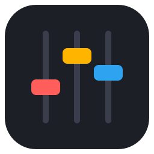

  

<h1 align="center">Mikser Studio</h1>

  <b>A multimedia studio you share with AI agents.</b> 
  Create and edit video, sound, images and more, with the AI tools you choose, local or online.

  
  
  
  
  

## What it does

Mikser Studio starts over in this repository, and it has no code here yet: everything below is planned. It is to be a video editor with an AI pipeline that you share with AI agents:

- **Commands for you and for agents** (planned): the interface, a local API and AI agents, through MCP, all run the same commands, so an agent can do whatever you can do in the editor.
- **Connectors to the AI tools you run** (planned): a connector lets Mikser Studio use an AI tool or service, on your computer or online. Connectors speak shared, open APIs, such as the OpenAI-compatible one many tools speak, so one connector serves every tool that speaks its API.
- **Open standards** (planned): Mikser Studio reads and writes open formats and speaks open protocols, rather than rebuilding other programs' features one by one.

The first version is to import, cut and export video, and an agent will be able to do all of it through the API.

## Getting started

Mikser Studio has no release and no code yet. This section fills in as the first version takes shape: how to install Mikser Studio and how to make a first cut.

## Questions

**Where is the earlier code?**
Mikser Studio began as a proof of concept, which is kept privately; nothing of it is published here. This repository starts from scratch.

**When can I try it?**
With the first release, which is to import, cut and export video. To hear when it comes, watch this repository on GitHub for releases (**Watch → Custom → Releases**).

## Contributing

Fixes and ideas are welcome: see [CONTRIBUTING.md](CONTRIBUTING.md).

<!-- shared-start: the text up to shared-end is the same in every project; change it only where all projects change together. -->

Found a security problem? Please report it privately, as [SECURITY.md](SECURITY.md) describes.

Further documentation:

<!-- shared-end -->

- [CONTRIBUTING.md](CONTRIBUTING.md): connectors and code
- [SECURITY.md](SECURITY.md): reporting a security problem

## Support

Mikser Studio is free, with no ads and no tracking. If it helps you, you can buy me a coffee:

<!-- shared-start: the text up to shared-end is the same in every project; change it only where all projects change together. -->

  
  

Ko-fi takes cards and PayPal; buycoffee.to suits supporters in Poland, with BLIK and Polish bank transfers.

<!-- shared-end -->

## License

Copyright (c) 2026 Infinitinker. Mikser Studio is free software under the GNU General Public License, version 3 or any later version (GPL-3.0-or-later); see [LICENSE](LICENSE).

The licenses of the libraries Mikser Studio ships with will be listed in `THIRD-PARTY-NOTICES.md`, which comes with the first dependency that ships.

Mikser Studio is not affiliated with or endorsed by the makers of the software it works with.
